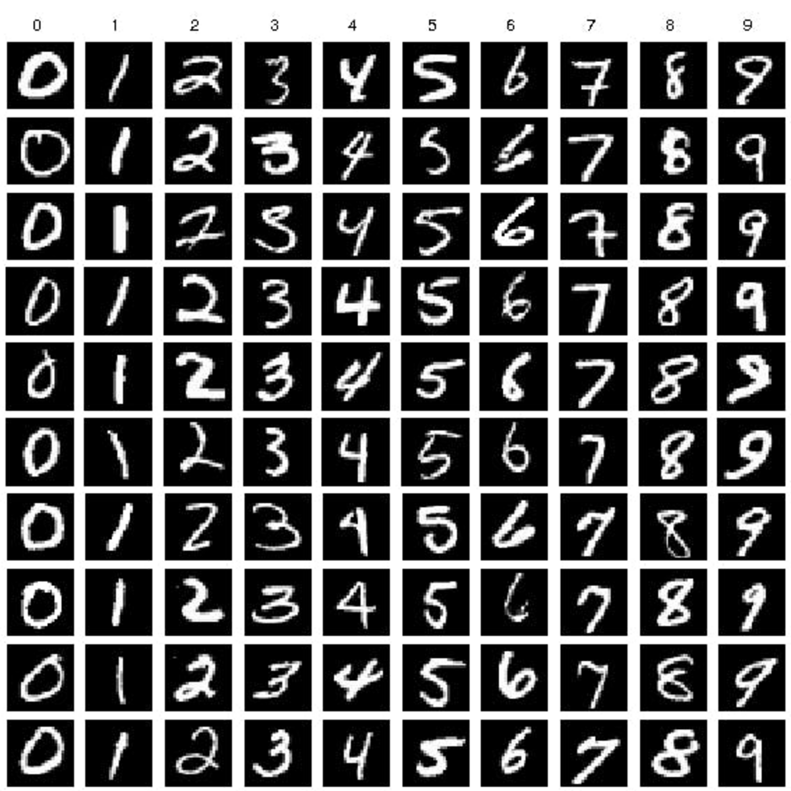

# MNIST Digit Classifier

A small handwritten-digit classification project built with PyTorch. It loads the MNIST IDX files, preprocesses the images and labels, trains a fully connected neural network, and plots training and test loss across epochs.



## What the project does

- Loads the MNIST training and test data from the `dataset/` directory.
- Scales image pixel values to the range `[0, 1]` and converts digit labels to one-hot vectors.
- Wraps the tensors in a PyTorch `Dataset` and uses `DataLoader` batches.
- Trains a feed-forward neural network with ReLU hidden-layer activations and a softmax output.
- Evaluates test accuracy and average loss after each epoch, then plots the loss curves.
- Includes a script for evaluating saved model weights and small scripts for inspecting the data and experimenting with the loss function.

## Project files

| File or directory | Purpose |
| --- | --- |
| `main.py` | Preprocesses the data, trains the network, evaluates each epoch, and plots the losses. |
| `neural_network.py` | Defines the `SimpleNN` PyTorch model. |
| `preprocess_data.py` | Loads MNIST and normalizes images and one-hot encodes labels. |
| `dataloader.py` | Defines the PyTorch dataset wrapper; running it directly displays a sample image. |
| `test_trained_models.py` | Loads saved weights and evaluates them on the MNIST test set. |
| `dataset/` | MNIST IDX image and label files used by the project. |
| `trained_models/` | Location of the included model checkpoint. |

## Requirements

- Python 3
- PyTorch
- Matplotlib
- `python-mnist`

Install the Python dependencies with:

```bash
pip install torch matplotlib python-mnist
```

## Run training

From the project directory, run:

```bash
python main.py
```

The current training settings are batch size 64, learning rate 0.1, 20 epochs, and a network with layer sizes `784 -> 128 -> 10`. The script prints test results after each epoch and opens a plot of training and test loss when training finishes.

## Evaluate a saved model

Run:

```bash
python test_trained_models.py
```

This script expects `trained_models/mnist_model.pth` to contain weights for the architecture `784 -> 128 -> 64 -> 10`. The training script currently uses a different architecture (`784 -> 128 -> 10`), and its model-saving line is commented out. Make sure the checkpoint and model architecture match before evaluating or saving new weights.

## Dataset

The repository includes the standard MNIST IDX files in `dataset/`, so the data loader expects to find them there. If you replace them, keep the same filenames and directory layout.